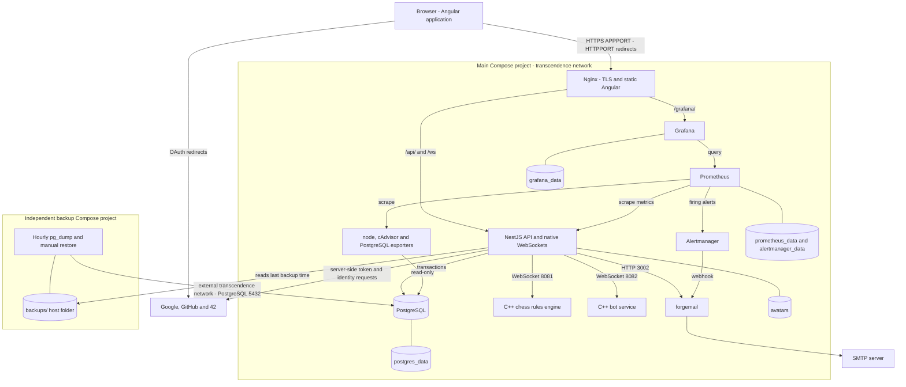

# Deployment architecture diagram

SCRUM-522 · Matches `srcs/docker-compose.yml` and the separate backup project
(updated 2 November 2026). See the [standalone SVG](architecture-diagram.svg)
for a portable, zoomable diagram.

Nginx strips `/api` before forwarding to NestJS, preserves `/ws` for upgrades
and serves the built Angular application. Every other service is internal: only
Nginx publishes ports (HTTPPORT and APPPORT). Grafana is reached through Nginx,
and the API's metrics are refused there (404): Prometheus scrapes them inside
the network.

Backup uses the existing `transcendence` network but a separate Compose lifecycle
and writes to a host folder, outside every volume. Dumps run hourly and retention
is 24 hours; a restore stops the application and is all or nothing. The API
reads the time of the last success (read-only mount) for the status page and the
alerts.

Development replaces Nginx with Angular's dev server/proxy on 4200, exposes
NestJS on APIPORT and Grafana on 3001, and uses source bind mounts. This diagram
shows production; it does not imply development TLS or an extra API instance.

Evidence: [main Compose](../srcs/docker-compose.yml),
[backup Compose](../backup/docker-compose.yml),
[Nginx](../srcs/angular/conf/nginx.conf),
[Prometheus](../srcs/prometheus/prometheus.yml),
[Alertmanager](../srcs/alertmanager/alertmanager.yml),
[recovery guide](../BACKUP.md).
