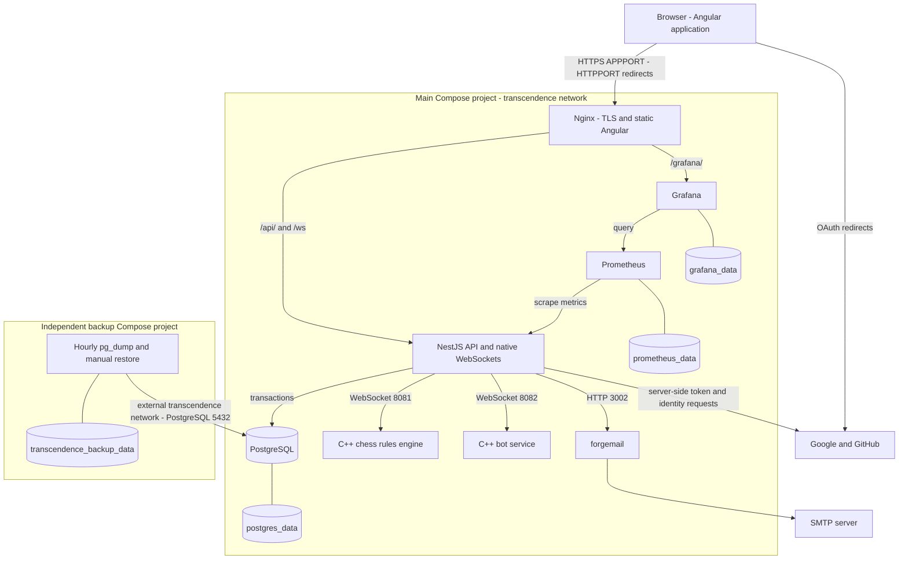

# Deployment architecture diagram

SCRUM-522 · Matches `srcs/docker-compose.yml` and the separate backup project
on `dev_test` at `062aaa6`. See the [standalone SVG](architecture-diagram.svg)
for a portable, zoomable diagram.

Nginx strips `/api` before forwarding to NestJS, preserves `/ws` for upgrades
and serves the built Angular application. Production NestJS, mail, rules and bot
services are internal; the Compose file additionally publishes PostgreSQL 5432
(via DATABASE_PORT) and Prometheus 9090. These host publications are operational
access paths, not frontend routes. Grafana is reached through Nginx.

Backup uses the existing `transcendence` network but a separate Compose lifecycle
and volume. Dumps run hourly and retention is 24 hours; restore is manual and
reverses database state. Live and backup volumes remain distinct.

Development replaces Nginx with Angular's dev server/proxy on 4200, exposes
NestJS on APIPORT and Grafana on 3001, and uses source bind mounts. This diagram
shows production; it does not imply development TLS or an extra API instance.

Evidence: [main Compose](../srcs/docker-compose.yml),
[backup Compose](../backup/docker-compose.yml),
[Nginx](../srcs/angular/conf/nginx.conf),
[Prometheus](../srcs/prometheus/prometheus.yml),
[recovery guide](../BACKUP.md).
