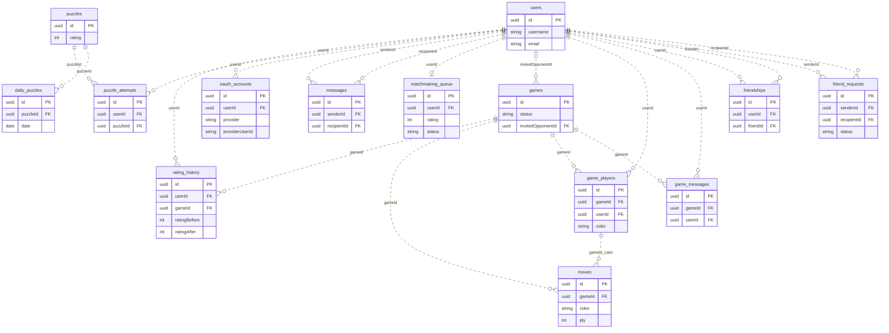

# Diagramme DB (DOC-16 / SCRUM-523)

Ce diagramme reflète les clés étrangères du schéma migré. Les attributs affichés
sont un sous-ensemble ; consulter le [dictionnaire complet](../srcs/nestJS/42chess/DATABASE-MODEL.md)
pour les types, champs nullables, contraintes et index. La source autonome est
[database-diagram.mmd](database-diagram.mmd).

`||` indique un parent obligatoire, `o|` zéro ou un, `o{` zéro ou plusieurs.
Les relations pointillées sont non identifiantes : chaque table enfant conserve
son propre UUID. Une partie peut avoir zéro à deux sièges, contrainte par les
couleurs et leur unicité ; Mermaid représente ici la relation générale un-à-plusieurs.
`moves` référence également le siège via la paire `(gameId, color)`.
Un utilisateur peut être invité dans plusieurs parties et chaque partie peut
avoir zéro ou un invité. Une entrée de queue est unique par utilisateur.
Les deux liens pour les messages, demandes et amitiés représentent deux rôles
sur la même table utilisateur, pas deux copies de données.
